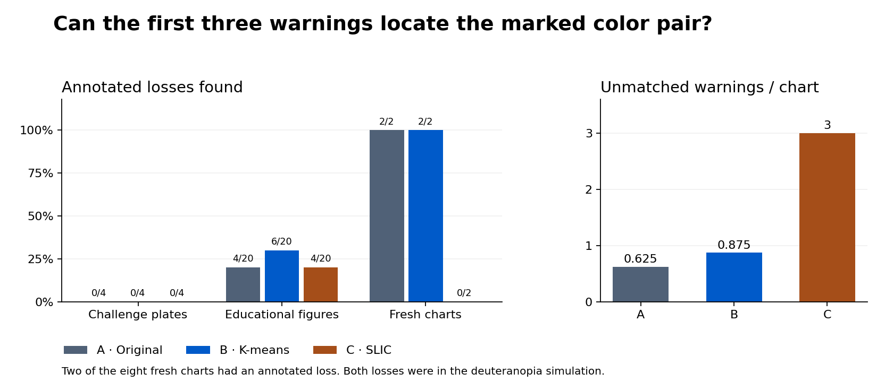

# Can PRISM find the two marks that lose their color distinction?

This earlier segmentation comparison included both members of matched pairs. Follow the [Stage 1 protocol](stage1.md) for the current color-only bank.

The 74/21 Ishihara plate scored 96/100 in PRISM's original page analysis, even though the engine found 17 major issues. In the Figure lab, both red–green simulations grade this plate **High concern**. Neither detector places the particular annotated numeral/background dot pair among its first three warnings. A page warning and a correctly located pair answer different questions.

## Fair demonstration

Open **Figure lab → Try the 74/21 plate**. Select Deuteranopia and inspect a warning. A solid outline identifies A and a dashed outline identifies B. ΔE measures the distance between their colors. Divide the simulated distance by the original distance to get the fraction retained. For example, 4 divided by 20 gives 20%. Switch profiles, then repeat on a textbook figure. The file picker accepts PNG, JPEG and PDF. Select a crop by dragging or entering pixel coordinates. Each measurement includes runtime on the current device.

Compare methods B and C on the same crop and profile. Both use unsupervised clustering. K-means learns a palette from the uploaded pixels. SLIC looks for similar colors near each local center and produces small connected patches. The same transparent rules rank pairs for both methods. Labels, patterns and reading-task performance require a separate interpretation.

## Experiment design

| Setting | Frozen choice |
| --- | --- |
| Independent variable for B versus C | Segmentation method |
| Version A | Original palette K-means, connected components, original neighbors and original 0–100 score. For the localization comparison, rank its existing issues by each profile's own risk. |
| Version B | Original segmentation with the new nearby-pair search and strongest-pair summary |
| Version C | SLIC in Lab + image coordinates, compactness 10, five local reassignment rounds. Split disconnected patches and retain components of at least four pixels. |
| Controlled inputs | Same source pixels and full-image crop, maximum edge 700 px, Pillow Lanczos resize, no OCR. The interactive viewer uses browser canvas resampling and can give different numbers. |
| Nearby pairs | Scan horizontally, vertically and along both diagonals at region boundaries. Allow a gap up to one nominal patch spacing, max(3, round(longest edge / 50)) pixels. |
| Eligible evidence | Original ΔE00 ≥ 12 and at least one patch with Lab chroma ≥ 12. Each pair is counted once per profile. Zero eligible pairs yields insufficient evidence. |
| Risk and grade | Use the existing Machado severity-100 simulations and ΔE00. Risk = 0.7 × clamp(1 − simulated distance / 12) + 0.3 × clamp(1 − retained fraction / 0.6), with both terms clamped to [0,1]. Grades start at 0.2 for review and 0.5 for high concern. These are engineering cutoffs. |
| Warning grouping | Group the same two coarse RGB bins (channel steps of 32) in the same local tile (eight spacings per side). Display the strongest representative and the number of contributing pairs. |
| Primary outcome | Inspect the top three warnings per figure and profile. A hit requires a single displayed representative to cover at least half of each reference disk, in either A/B order. |
| Additional outcomes | Count unmatched displayed warnings on graded profiles, warnings on annotated retained pairs, insufficient-evidence cases and elapsed analysis time. Sparse annotations mean an unmatched warning can still identify another real change. |
| Decision | Adopt SLIC if it finds more annotated losses on fresh figures without increasing the average unmatched warnings per figure. Otherwise use B as the figure-lab default. |

The development bank is the existing 20 images. Fifteen have graded color-pair references. Four nature photographs have exploratory results, and the reverse plate has its own category. Plate 19 can reveal a numeral under simulation. A method that looks for lost separation cannot establish whether that numeral emerges. All variants of each source are in one partition.

The eight fresh charts are from eight gallery documents published by Matplotlib and seaborn. Images are stored unmodified with their license notices in `fresh/`. The key records source pages, SHA-256 hashes, image dimensions, paired coordinates, RGB samples and expected profiles. Reference locations were chosen on the originals before running A, B or C. For the fresh charts, Colorspacious and scikit-image independently calculated separation at those locations. Among pairs with original ΔE ≥ 12, label loss when simulated ΔE < 12 and retention < 0.6, and retention when simulated ΔE ≥ 20 or retention ≥ 0.85. Leave the rest ungraded. Development expectations come from the plate or figure design and can disagree with simulated color distances.

## Recorded results



All 20 original page scores reproduced. Entries below count localized losses in the first three warnings. Each denominator counts a pair in one profile.

| Figures and profile | A · original | B · K-means | C · SLIC |
| --- | ---: | ---: | ---: |
| Challenge plates 09 and 11, protanopia | 0/2 | 0/2 | 0/2 |
| Challenge plates 09 and 11, deuteranopia | 0/2 | 0/2 | 0/2 |
| Educational figures, protanopia | 0/8 | 0/8 | 0/8 |
| Educational figures, deuteranopia | 2/8 | 4/8 | 2/8 |
| Educational figures, tritanopia | 2/4 | 2/4 | 2/4 |
| Fresh charts, deuteranopia | 2/2 | 2/2 | 0/2 |

Both fresh loss references were deuteranopia cases. The fresh bank contributes retained controls but no positive localization evidence for the other two profiles. Unit swatches test loss and retention independently in each simulation. All three methods produced eligible pairs on every benchmark image/profile. A separate monochrome test verifies insufficient evidence.

| Fresh charts (8 figures, 22 graded figure/profile cases) | A | B | C |
| --- | ---: | ---: | ---: |
| Unmatched displayed warnings / figure | 5/8 = 0.625 | 7/8 = 0.875 | 24/8 = 3.00 |
| Annotated retained comparisons flagged | 0/20 | 0/20 | 0/20 |
| Median compute time on the development machine | 47 ms | 32 ms | 180 ms |

For the control plate 01, B gave low measured concern in both red–green profiles. C gave high concern in protanopia and review in deuteranopia, although its top three warnings missed the retained control pair itself. In educational figures, B localized six of the twenty provisional losses. The two tritan figures are included with their marked variants. The simulator can preserve more separation than a design label anticipates, and a thumbnail-sized region or a distant legend can defeat this local search.

**Decision:** Keep B as the figure-lab default. C remains selectable for the experiment. A tied B on fresh localization and generated fewer unmatched warnings. The evidence supports replacing the pooled page score with interpretable profile warnings for this task. Accuracy on unfamiliar classroom material and human reading performance remain open questions. These eight charts have now been evaluated and would be development material for any subsequent tuning.

## Reproduce and present

Run from the PRISM repository with its Node dependencies installed and Python with Pillow on PATH.

```sh
npm test
npm run benchmark:figures -- development
npm run benchmark:figures -- fresh
```

The comparison checks image hashes, verifies A against the saved page scores, and writes one CSV per split. Runtime is repeated on each of the three profile rows for a figure. Count it once per figure and method. Blank `extra` means that profile was ungraded. Pair IDs in CSV are zero-based. The interface numbers regions starting at one. The frozen key SHA-256 for this run is `57cdb50a1f8aea40cb65c974eef6297127703ab2cc2c084f80e25d975049b19c`. The optional key-building script requires NumPy, Pillow, scikit-image and Colorspacious. Keep the frozen key for reproduction.

For the Canada-Wide Science Fair Innovation presentation, use the controlled B/C comparison for scientific thought, explain why the local pairing and summary were chosen for originality, and demonstrate a success and a missed pair for communication. In the student's logbook, record a prediction, the crop, the two measured distances, the observed outcome, and one explanation to test next. Credit the existing PRISM engine, the source figures, the published algorithms, and the coding assistance used here. Distinguish the student's own experiments, decisions and observations. [CWSF judging guide](https://mystemspace.ca/resources/understanding-the-stem-project-judging-process/) · [SLIC authors](https://ivrlwww.epfl.ch/supplementary_material/RK_SLICSuperpixels/) · [Machado et al.](https://pubmed.ncbi.nlm.nih.gov/19834201/)

