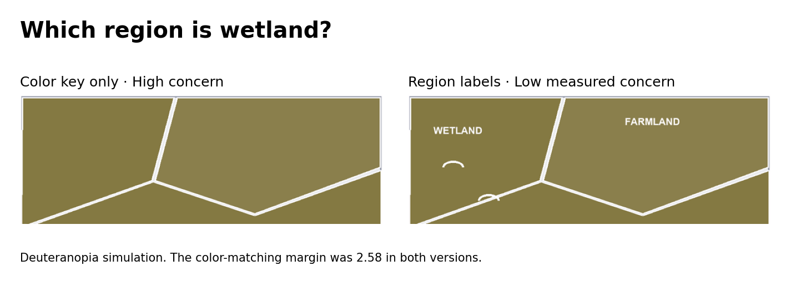

# Does the information needed to answer a textbook question survive CVD simulation?

**Stage 2 background.** This earlier exploratory prototype studies reading tasks and cue effectiveness. The active science fair experiment uses the [Stage 1 color-only protocol](../stage1.md).

**Proposal.** For each learning question, identify the marks the reader must distinguish and the evidence that identifies them. Simulate each CVD profile. Test whether the reader's intended answer still has a distinguishable color, a correctly associated label, or another independently verifiable cue. Use the comparison with the original to flag information already difficult in the source. An unsupported question gets an unresolved result. For a chapter, show the highest concern among required tasks, its page and figure, and how many tasks were tested.

**What was tested.** The command-line prototype handles two-choice color-key and direct-label questions. A small nearest-prototype classifier matches each mark to its two legend colors. OCR checks the intended location for a direct label. A target name beside the competing mark yields unresolved. The task and locations are supplied by an annotator. A second experiment uses held-out color samples within a picture to test whether two sets of marks remain distinguishable. This research prototype is separate from PRISM's browser Figure Lab.



## Controlled textbook comparison

The same map, with the same colors and geometry, received **100/100** in both versions of the old page score. The deuteranopia simulation gave a color-matching margin of **2.58 ΔE** in both versions. The task score moved from **2 (high concern)** to **0 (low measured concern)** when OCR recovered WETLAND within the marked map region. The printed map key appeared in both versions and was outside the attached-label window.

The primary outcome was whether a labeled variant received a lower risk grade than its color-only partner. There were six source families, twelve images and ten designated family/profile comparisons. The old page score is shared across profiles. The color-only and color-plus-label decoders used exactly the same task annotations and image settings.

| System | Improved | Tied | Reversed | Unresolved | Families improving in every designated profile |
| --- | ---: | ---: | ---: | ---: | ---: |
| Original page score | 2/10 | 7/10 | 1/10 | 0/10 | 1/6 |
| Task-specific color matching | 0/10 | 10/10 | 0/10 | 0/10 | 0/6 |
| Task-specific color matching and label reading | 4/10 | 6/10 | 0/10 | 0/10 | 1/6 |

The full decoder improved in **3/4 deuteranopia**, **1/2 tritanopia**, and **0/4 protanopia** comparisons. All four protanopia comparisons used the same underlying pair of colors. Its simulated margin was 14.68, already above the low-concern cutoff. The timeline and museum-route labels were visible in the OCR transcription, but their confidence fell below the frozen 75 threshold. For instance, ROUTE scored 64. These observations explain both useful behavior and missed improvements. Six source families with related palettes provide limited independent evidence.

On 24 generated controls, all 24 predefined outcomes held. Across the three targeted simulations and two target positions, attached correct labels resolved 6/6 cases, swapped labels produced 6/6 explicit contradictions, decorative labels left 6/6 cases high concern, and missing labels left 6/6 cases high concern. These are controlled variations of a single layout. Their purpose is to catch coding and cue-association errors.

## Pictures without a legend

A second test used six manually selected examples of each class per image. Each fold classified one held-out sample from each class using the other five as examples. Counts give originally well-separated samples that became weak / originally well-separated samples. Each row is one source image.

| Image and distinction | Protanopia | Deuteranopia | Tritanopia |
| --- | ---: | ---: | ---: |
| Control 12, numeral and field | 0/11 | 0/11 | 0/11 |
| 74/21 plate, original numeral and field | 2/9 | 2/9 | 0/9 |
| Disappearing 6, numeral and field | 11/11 | 8/11 | 0/11 |
| Autumn leaves, red and green foliage | 7/10 | 10/10 | 0/10 |
| Sumac, berries and leaves | 0/12 | 0/12 | 1/12 |

The disappearing-6 result supports the predicted direction. The modest response to the 74/21 plate illustrates a limitation: reading a transformed numeral depends on the spatial arrangement of many dots. The berry result also leaves open how difficult it is to locate a tiny target in a busy picture. Report these as tests of sampled visual evidence. A user completing the whole task may use additional clues or face additional barriers.

## Reproduce

The experiment uses Python, Pillow, NumPy, scikit-image, Colorspacious and the repository's installed Node dependencies. The English OCR model runs locally. From the repository root:

```sh
python scripts/task_reading.py
python scripts/test-picture-reading.py
```

To score another two-choice figure, save one task object from `tasks.json` as a separate JSON file, replace its names and coordinates with those for the new figure, and run `python scripts/task_reading.py --image figure.png --task question.json`. Coordinates are pixels on the original image. The first listed class is the target. The output includes original and simulated margins, OCR text and confidence, grade, and any contradiction.

[Textbook protocol and next independent test](protocol.md) · [Picture protocol](picture-protocol.md) · [Textbook and control measurements](observations.csv) · [Picture measurements](picture-observations.csv)

